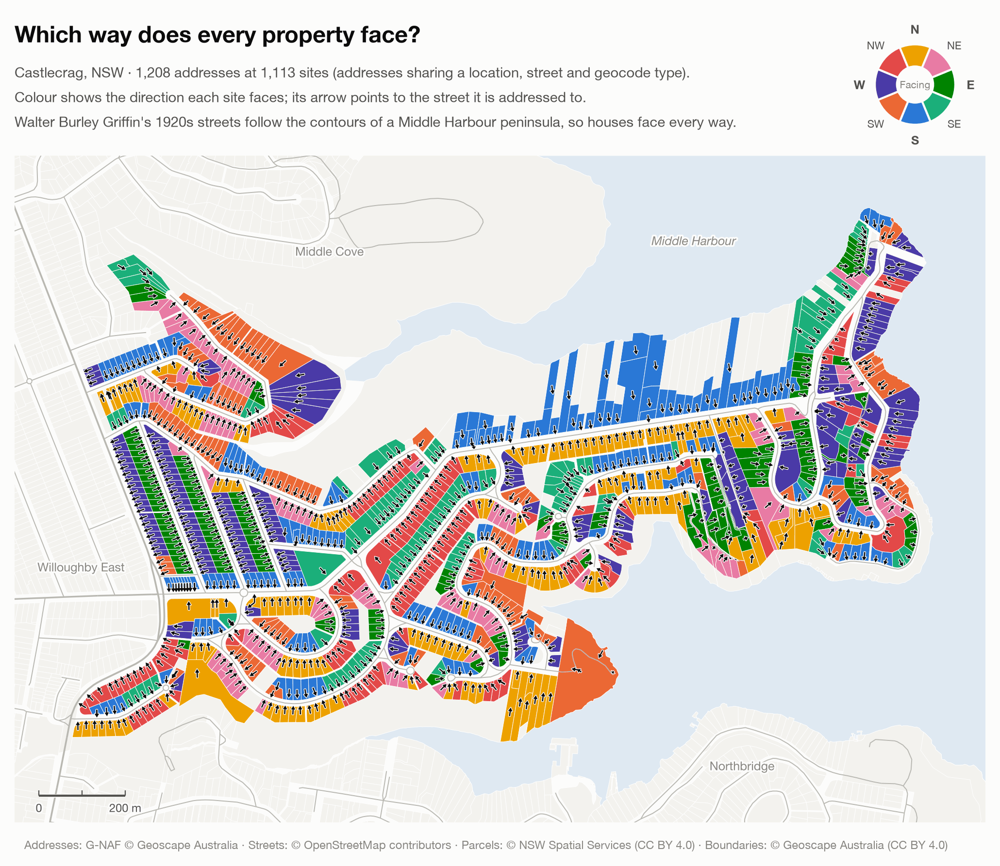
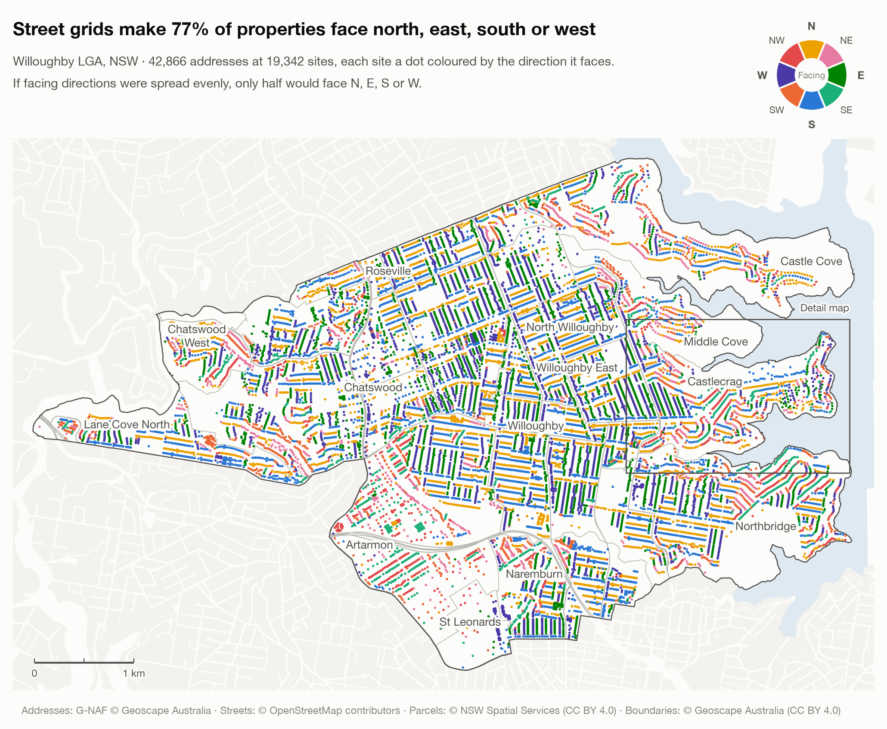
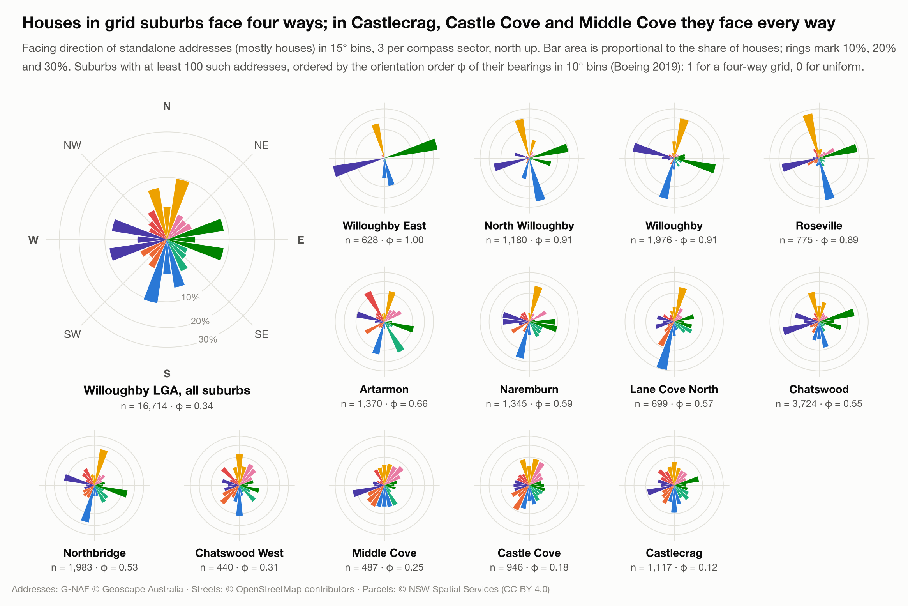
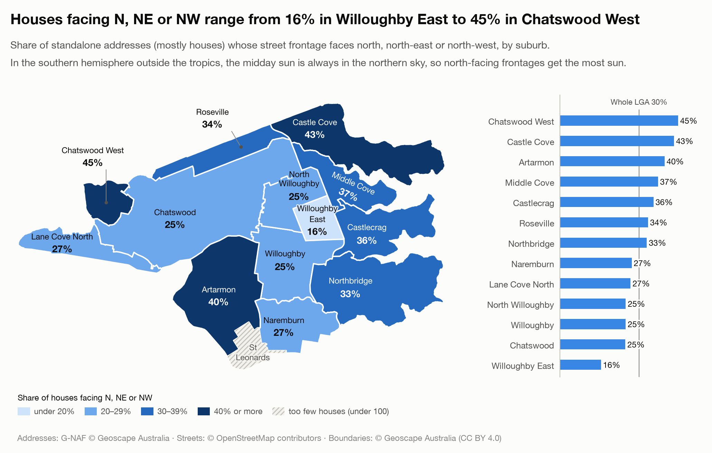
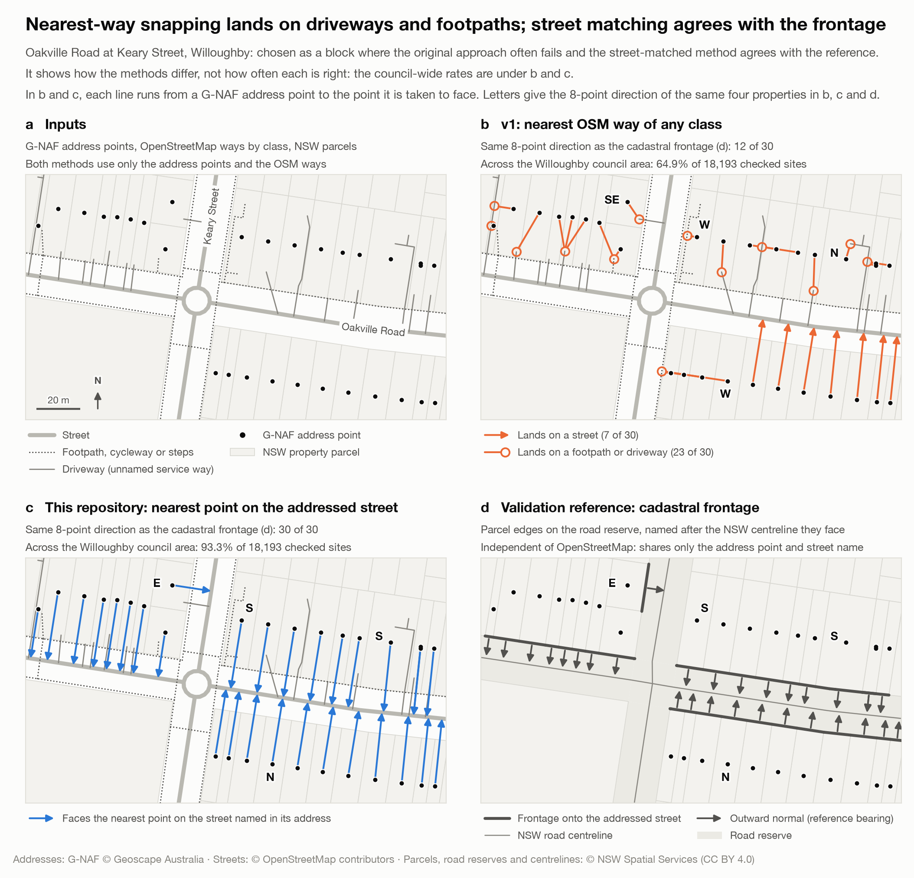
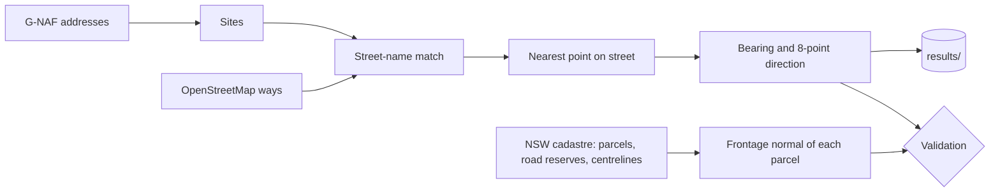
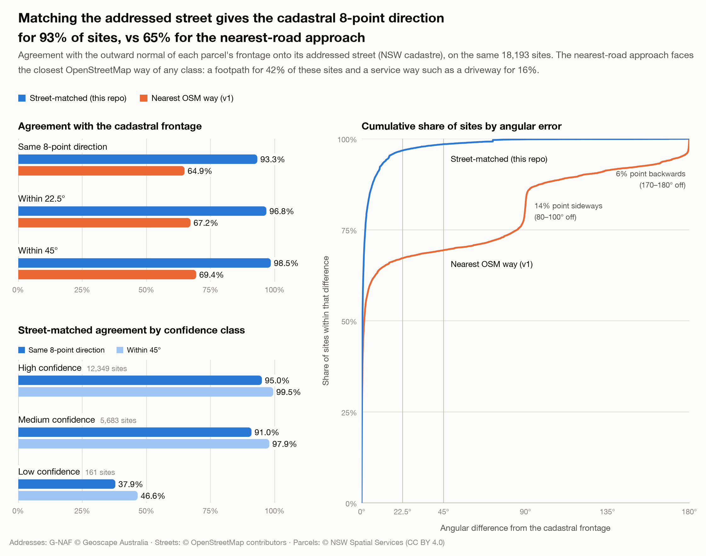
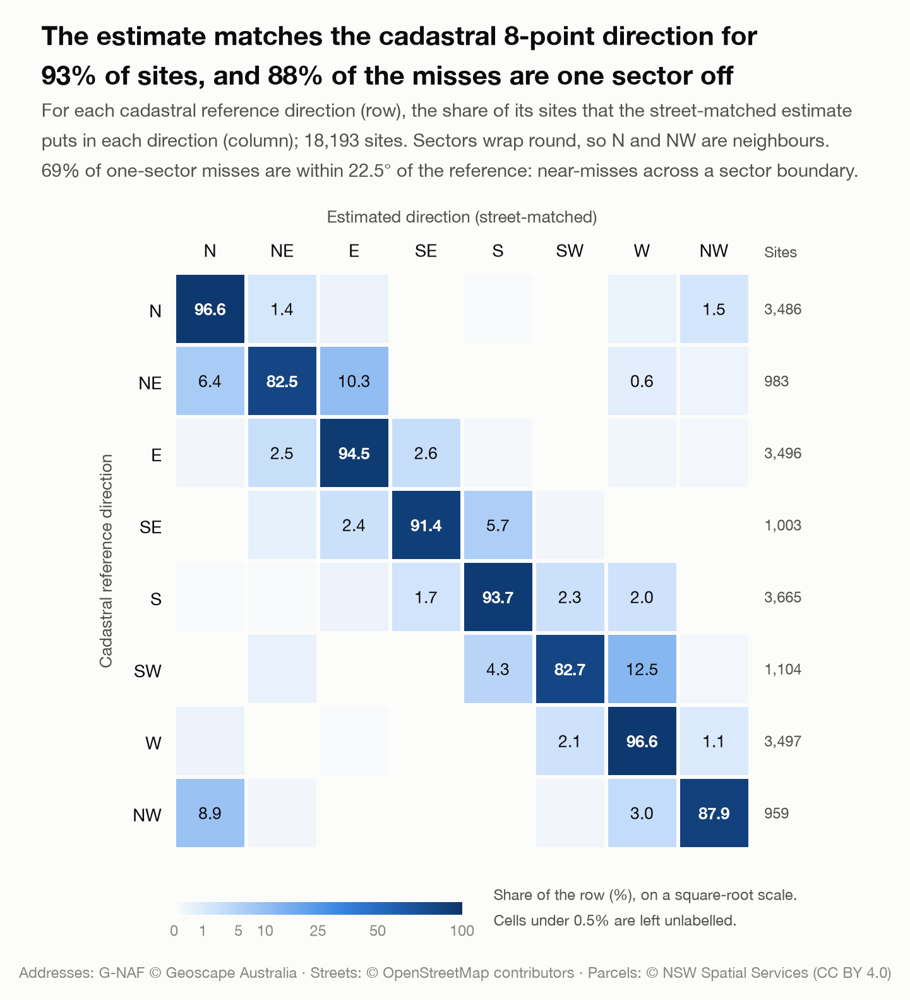

<h1 align="center">GIS Map Compass for Property Orientation</h1>

<p align="center">
  <b>Which way does every property face?</b><br>
  Street-frontage orientation for every principal G-NAF address in an Australian council area,<br>
  from G-NAF addresses and OpenStreetMap streets, validated against the NSW cadastre.
</p>

<p align="center">
  <a href="https://github.com/midhunshyam/property-orientation/actions/workflows/ci.yml"></a>
  
  
  
</p>

<p align="center"></p>

<p align="center">
  <a href="#results">Results</a> ·
  <a href="#look-up-an-address">Look up an address</a> ·
  <a href="#method">Method</a> ·
  <a href="#validation">Validation</a> ·
  <a href="#outputs">Outputs</a> ·
  <a href="#quickstart">Quickstart</a> ·
  <a href="https://midhunshyam.github.io/property-orientation/map/">Interactive map</a>
</p>

---

## Results

Every principal G-NAF address in **Willoughby City Council** (Sydney, NSW):

| | |
|---|---|
| Addresses | **43,551**, at 19,436 sites (addresses sharing one location, street and geocode type) |
| Orientation reported | **42,866** addresses (98.4%). Of the rest, 386 are geocoded only to their street, and 299 share one site at 1 Anderson Street, Chatswood (a shopping centre: 279 shops, 18 kiosks, one level and the centre's own address) whose geocode lies on the street centreline |
| Agreement with the cadastral frontage | **93.3%** same 8-point direction · **98.5%** within 45° · median error **0.5°** |
| Same check for the nearest-road approach | 64.9% · 69.4% · 90th-percentile error 121° |
| Runtime | ≈ 9 s for `make run` on an Apple M1 laptop, after a one-off download of open data (a few minutes) |

<p align="center"></p>

* **Street grids decide.** 77% of standalone addresses (mostly houses) face one of the four
  cardinal directions. In grid suburbs such as Willoughby East the share is 99.5%.
* **Contour-following suburbs face every way.** Castlecrag, Castle Cove and Middle Cove were laid
  out along the contours of Middle Harbour; Walter Burley Griffin designed Castlecrag in the
  1920s. Their facings are the least ordered in the council area: orientation order φ is 0.12,
  0.18 and 0.25, against 0.89–1.00 in the grid suburbs (φ = 1 is a perfect four-way grid,
  0 a uniform spread; Boeing 2019).
* **North matters in the southern hemisphere.** The share of houses with a northerly frontage
  (N, NE or NW) ranges from 16% in Willoughby East to 45% in Chatswood West.

<p align="center"></p>

<p align="center"></p>

A few rows of [`results/willoughby/property_orientation.csv`](results/willoughby/property_orientation.csv):

| address | orientation | bearing_deg | street | distance_to_street_m | confidence |
|---|---|---|---|---|---|
| 22 THE PARAPET, CASTLECRAG NSW 2068 | N | 338.2 | The Parapet | 37.6 | high |
| 23 THE RAMPART, CASTLECRAG NSW 2068 | S | 170.4 | The Rampart | 30.5 | high |
| 27 THE PARAPET, CASTLECRAG NSW 2068 | SW | 220.4 | The Parapet | 28.4 | high |
| 109 EASTERN VALLEY WAY, CASTLECRAG NSW 2068 | W | 252.1 | Eastern Valley Way | 27.9 | high |
| 7 CHARLES STREET, CASTLECRAG NSW 2068 | W | 249.3 | Charles Street | 29.2 | medium |

The last row is a corner lot. Edith Street is closer to the address point than Charles Street,
so the result is capped at `medium` even though it is right.

## Look up an address

The Willoughby results are committed, so this works straight after installing, with no
download:

```bash
make setup
make lookup ADDRESS="22 The Parapet, Castlecrag"
```

```
22 THE PARAPET, CASTLECRAG NSW 2068
  Faces       N (north), bearing 338.2° from true north
  Street      The Parapet, 37.6 m from the address point
  Rear faces  S (south)
  Confidence  high
```

Or call the command directly, for example `property-orientation lookup 3/14 Brown St Chatswood`,
and add `--json` for machine-readable output. Matching ignores case and punctuation, accepts
`St`/`Street`, `Rd`/`Road` and unit shorthand such as `3/14`, and suggests the closest addresses
when nothing matches. For another council, run `make data run LGA="..."` first. The interactive
map has an address search too.

## Method

A property faces the street it is addressed to. Its orientation is the bearing from the address
point to the nearest point on that street.

<p align="center"></p>

1. **Sites.** Addresses that share a location, a street and a geocode type, such as the units of
   one building, form one site. 43,551 addresses become 19,436 sites.
2. **Match the addressed street.** G-NAF (`MOWBRAY` + `ROAD` + `WEST`), OpenStreetMap
   (`Mowbray Road West`) and NSW (`MOWBRAY RD W`) spellings are normalised to one form. Each
   site takes the nearest OSM way carrying its street's name, preferring ways a property can
   front (streets, pedestrian streets and named lanes) over footpaths; 99.95% of
   sites match by name. If G-NAF's street has a suffix that the OSM way lacks (`MARKET STREET
   EAST` against `Market Street`), the match is kept but marked low confidence, because the
   suffixed street is often a separate street missing from OSM. With no name match, the site
   falls back to the nearest street a property can front (never a footpath, cycleway or
   driveway), also at low confidence.
3. **Face the street.** The bearing is the geodesic azimuth on the GRS80 ellipsoid from the
   address point to the nearest point on that street. It is measured from true north, not MGA
   grid north (they differ by ≈ 1° in Sydney), and binned into eight 45° sectors.
4. **Grade confidence.** `high`, `medium`, `low` or `none`, from the match type, the distance
   to the street, the geocode type, and whether another street is closer
   ([rules](results/README.md#confidence-classes)).

Geometry operations are vectorised with Shapely 2 (`STRtree`, `shortest_line`). Full details are
in [docs/methodology.md](docs/methodology.md).



## Validation

The check has to be independent of OpenStreetMap, so the reference geometry comes from the
**NSW Digital Cadastral Database**. It shares only the G-NAF address point and street name with
the method. For each site:
1. Find the property parcel that contains the address point.
2. Keep the parts of its boundary that touch a road reserve: its *frontage*.
3. Name each frontage edge after the road centreline that its outward normal crosses.
4. Take the length-weighted mean normal of the frontage onto the *addressed* street.

<p align="center"></p>

| Method (18,193 sites on 15,864 parcels) | Same 8-point direction | Within 22.5° | Within 45° | Median error | 90th pct error |
|---|---|---|---|---|---|
| **Street-matched (this repository)** | **93.3%** | **96.8%** | **98.5%** | **0.5°** | **8.1°** |
| Nearest OSM way of any class (the v1 approach, re-run on the same data) | 64.9% | 67.2% | 69.4% | 1.5° | 121° |

The nearest-road approach is right when the nearest way is the street. But Sydney's
OpenStreetMap draws footpaths and driveways as separate ways, and they lie closer to the address
point. It snaps to a footpath (OSM `footway`) at 42% of sites and to a driveway or lane (`service`)
at 16%. Footpaths usually run
parallel to the street, so 78% of those snaps still point the right way; driveway and lane snaps
are wrong 79% of the time. Overall it is more than 45° off at 30.6% of sites, against 1.5% for
street matching. Street matching fixes 5,408 of those sites and makes 114 worse (both counted
at 45°).

The first version of this repository published five sample rows, computed from a 2025
OpenStreetMap extract. Four of them disagree with the cadastre:

| Address | v1 published (nearest way of any class) | This repository | Cadastral reference |
|---|---|---|---|
| 7 Charles Street | N 6.7° (snapped to Edith Street) | **W 249.3°** | 249.7° |
| 22 The Parapet | SE 155.5° (snapped to a path behind the house) | **N 338.2°** | 340.4° |
| 24 The Parapet | S 177.5° (snapped to a path behind the house) | **N 351.2°** | 348.7° |
| 27 The Parapet | SW 220.3° | **SW 220.4°** | 220.5° |
| 109 Eastern Valley Way | E 70.0° | **W 252.1°** | 249.9° |

**It generalises.** The confidence thresholds were set on Willoughby. The same code on a nearby
council it was not tuned on, Hunters Hill (7,200 addresses, 3,828 evaluated sites), gives 91.4%
same-direction agreement and 97.2% within 45°, against 68.3% and 73.1% for the nearest-road
approach. To repeat it: `make data run LGA="Hunters Hill"`. The numbers will move a little as
OpenStreetMap is edited; `run_summary.json` records the snapshot used.

The confidence classes separate reliable from doubtful estimates. The `low` class is small and
concentrated: 161 of its 199 sites have a reference, they sit on just 41 parcels, and one campus
parcel on Herbert Street, Naremburn holds 63 of them.

| Confidence | Sites | Parcels | Same 8-point direction | Within 45° |
|---|---|---|---|---|
| high | 12,349 | 12,082 | 95.0% | 99.5% |
| medium | 5,683 | 3,909 | 91.0% | 97.9% |
| low | 161 | 41 | 37.9% | 46.6% |

<p align="center"></p>

88% of the disagreements (1,081 of 1,228) are with a neighbouring sector. Most of those (69%)
are within 22.5° of the reference: near-misses across a sector boundary. That is why agreement
within 22.5° (96.8%) is higher than same-sector agreement (93.3%). Per-suburb figures are in
[`results/willoughby/validation/`](results/willoughby/validation/).

## Outputs

| File | Content |
|---|---|
| [`results/willoughby/property_orientation.csv`](results/willoughby/property_orientation.csv) | one row per address: `gnaf_pid`, `address`, `orientation`, `bearing_deg`, `street`, `distance_to_street_m`, `match`, `confidence`, … |
| [`results/willoughby/property_orientation.gpkg`](results/willoughby/property_orientation.gpkg) | GeoPackage for QGIS/ArcGIS: `addresses`, `facing_lines` (address → street), `suburbs`, `study_area` |
| [`results/willoughby/summary_by_suburb.csv`](results/willoughby/summary_by_suburb.csv) | direction mix of houses per suburb |
| [`results/willoughby/validation/`](results/willoughby/validation/) | agreement with the cadastre: per method, confidence class and suburb, plus the confusion matrix |
| [`docs/map/index.html`](docs/map/index.html) | interactive map of every site (served at the *Interactive map* link above) |

Column definitions and the confidence rules are in [results/README.md](results/README.md).

## Quickstart

Requires Python 3.10+. Downloads use public, keyless endpoints.

```bash
git clone https://github.com/midhunshyam/property-orientation.git
cd property-orientation
make setup     # .venv + package with extras (add PYTHON=python3.12 to pick an interpreter)
make data      # G-NAF, OpenStreetMap and NSW cadastre for Willoughby (a few minutes)
make run       # orientation + validation -> results/willoughby/
make figures   # README figures -> docs/images/
make test      # offline test suite
```

Other councils work the same way: `make data run LGA="Hunters Hill"`. Outside NSW, pass the
state too, for example `make data run LGA="Queenscliffe" STATE=VIC`. Validation needs the NSW
cadastre, so it runs only for NSW areas; elsewhere the method runs on G-NAF and OpenStreetMap
alone. `make webmap` maps any council (into `docs/map/<council>/`); the README figures are
drawn for Willoughby only. The committed figures were rendered with matplotlib 3.11 (Agg
backend) and the Helvetica Neue font; other versions and fonts give slightly different pixels.

From Python:

```python
import geopandas as gpd
from property_orientation import compute_orientation

addresses = gpd.read_parquet("data/raw/willoughby/addresses.parquet")  # G-NAF points
roads = gpd.read_parquet("data/raw/willoughby/osm_highways.parquet")  # OSM ways
result = compute_orientation(addresses, roads, crs=7856)  # GDA2020 / MGA 56
result.sites[["street_key", "orientation", "bearing_deg", "confidence"]].head()
```

A step-by-step walkthrough on Castlecrag is in
[notebooks/walkthrough.ipynb](notebooks/walkthrough.ipynb).

## Repository layout

```
├── src/property_orientation/
│   ├── streets.py        street-name normalisation (G-NAF / OSM / NSW)
│   ├── orientation.py    the method: sites, street matching, bearing, confidence, baseline
│   ├── reference.py      cadastral frontage reference (validation only)
│   ├── validation.py     agreement metrics and confusion matrix
│   ├── lookup.py         address search behind `property-orientation lookup`
│   ├── geometry.py       bearings, compass sectors, MGA zones
│   ├── sources/          G-NAF (DuckDB over GeoParquet), Overpass, NSW ArcGIS REST
│   ├── pipeline.py       fetch -> run stages; outputs.py writes results/
│   └── viz/              figures and the interactive map
├── results/willoughby/   committed outputs (see results/README.md)
├── docs/                 methodology, figures, interactive map
├── notebooks/            executed walkthrough
└── tests/                offline pytest suite, with two small real-data fixtures
```

## Data and licences

| Data | Source | Licence |
|---|---|---|
| Addresses | [G-NAF](https://data.gov.au/dataset/geocoded-national-address-file-g-naf), Geoscape release 2026-08, via the [gnaf-loader](https://github.com/minus34/gnaf-loader) GeoParquet export | [Open G-NAF End User Licence Agreement](https://data.gov.au/dataset/geocoded-national-address-file-g-naf) |
| Suburb and LGA boundaries | Geoscape Administrative Boundaries, release 2026-08 | [CC BY 4.0](https://creativecommons.org/licenses/by/4.0/) |
| Streets | © [OpenStreetMap](https://www.openstreetmap.org/copyright) contributors, via the Overpass API | [ODbL 1.0](https://opendatacommons.org/licenses/odbl/1-0/) |
| Parcels, road reserves, road centrelines (validation) | NSW Digital Cadastral Database, © Spatial Services (DCS), NSW Government | [CC BY 4.0](https://creativecommons.org/licenses/by/4.0/) |

The code is MIT-licensed ([LICENSE](LICENSE)). The derived data in `results/`, `docs/` and
`tests/fixtures/` keeps the licences of its sources, listed above.

## Limitations

* **Frontage, not façade.** The method reports the direction of the street frontage. Corner
  houses, and houses turned to a view, can face elsewhere. For solar access, the rear of
  the lot faces `bearing_deg + 180°` (`property_orientation.opposite`).
* **Units share their building's orientation.** Individual apartments can face any side.
* **Large sites.** Schools and campuses carry building-centroid geocodes far from the street,
  so they get `medium` or `low` confidence.
* **The reference is geometric.** It encodes the same frontage concept from independent data.
  It does not observe front doors.
